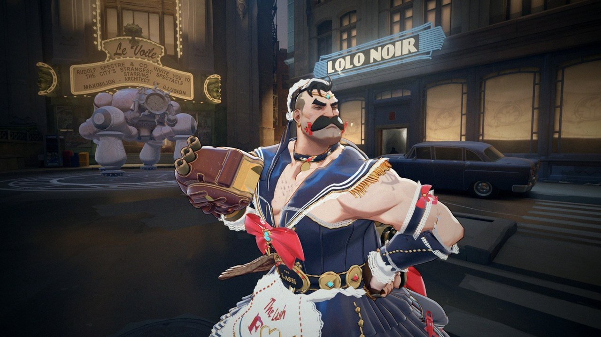
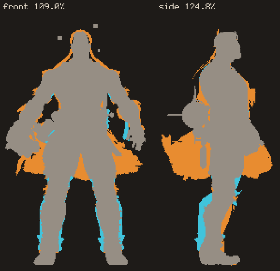
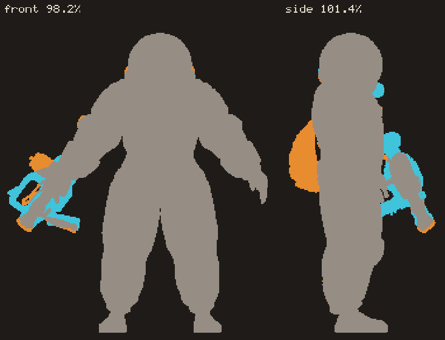
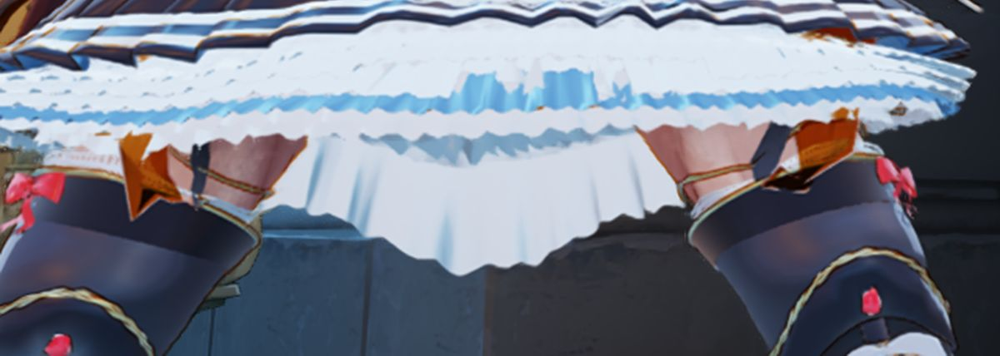
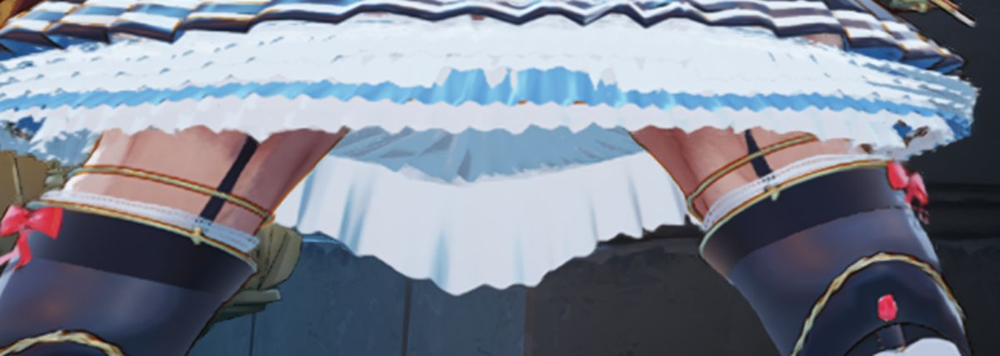

# Magician

Magician is a headless toolchain for creating, validating, and maintaining Deadlock mods through automation, scripts, and AI agents.

It treats a Deadlock mod the way a compiler treats a program, and each game build the way a compiler treats a target. A mod is built reproducibly from its sources, linted against the build that is installed, re-linked when Valve ships a new one, graded for which parts of a hero it makes its own, and installed or rolled back without touching a file Magician didn't put there. Every one of those steps is a command with a deterministic answer and an exit code that means something, so a script or an agent can run the whole loop with nobody at the desk. A person can run the same commands; they just aren't where the design starts.

Named for The Magnificent Sinclair, Deadlock's own magician, and a sibling to [Mycelium](https://github.com/worflor/mycelium), which does the same job for Minecraft mods.

<p>
  <a href="docs/SHOWCASE.md"></a>
  <a href="docs/SHOWCASE.md"></a>
</p>

Two of the three full hero skins made with it: [Maid Lash](https://woflo.dev/deadlock-skins/maid-lash/), public, with an in-game proof on each of the four builds from 6864 to 6868, and Lööps Viscous, still in production. [What Magician says about each](docs/SHOWCASE.md), in its own output.

**[woflo.dev/magician](https://woflo.dev/magician/)** walks a mod through all of it, in pictures.

## What it does to a mod

1. **Build the mod and pack it.** `magician build` compiles an addon's sources with the CSDK's compiler, packs what belongs in the mod into one VPK and lints it, working round the compiler's known quirks and naming anything it leaves out. Packing is deterministic: the same compiled files give the same pak, byte for byte, so a proof can name exact bytes.
2. **Check every file the way the game will read it.** Each file in the mod is set beside Valve's at the same path in the build you have installed, and the report says what a player would see if it shipped: a pink checkerboard where a material is missing, a hero that breaks at the next patch because the mod ships Valve's skeleton, a hem you can see through from below. What Valve's own file already does is never blamed on the mod.
3. **Fair play.** Some players don't mind what an enemy looks like as long as they know where to shoot. Others want a skin that changes nothing about how the hero reads in a fight. Magician compares the skin with the stock hero (its silhouette from every side, how far it reaches past the hitboxes, each ability's effect against Valve's) so those players can check before they install. If you make skins, the same numbers show how far a part goes past the limit and where, so you can pull it back in or keep it with a written reason.

   <p>
     
     
   </p>

4. **Look at it in the game.** A clean check is not the end. Magician launches the real game, plays the mod's own scenarios, and cuts each take into a contact sheet for a person, or an agent that reads images, to look at. This is what the look caught under Maid Lash's petticoat, before and after the fix:

   <p>
     
     
   </p>

5. **Record the proof.** Once the frames have been looked at, Magician records it: this game build, these exact bytes. Rebuild the mod and it starts unproven again, so nothing ships on an old proof.
6. **Survive the patch.** When Valve ships an update, one offline command says what changed under every installed mod: still fine, needs a look in game, or broken, and why.

`magician check` in a mod's folder gives one verdict on the built paks: their check and fair play, their proof, and what the last patch changed under them.

## Getting started

You need Windows 10 or 11, or Linux on x86-64, with Deadlock installed through Steam (on Linux the game runs under Proton, and the files Magician reads and writes are the same).

**From source.** A stable Rust toolchain is all it takes. The workspace has no external crates, so the build downloads nothing.

```
git clone https://github.com/worflor/magician
cd magician
cargo build --release              # target/release/magician (magician.exe on Windows)
cargo test --workspace             # synthetic fixtures only: needs no game and no Valve file
```

**From a release.** A release is the same toolkit folder already built, one archive per platform: `magician-windows-x64.zip` and `magician-linux-x64.tar.gz`. Unpack it anywhere and put the folder on PATH, or call the program by its path; it finds the rest of the folder from where it sits. Nothing else is installed, so there is nothing to uninstall: delete the folder.

Commands here are written once for both systems: `magician` is the program, paths use `/` (Windows takes it too), and `python` is the Python 3 on PATH, which most Linux distributions call `python3`.

Then let it tell you where you stand:

```
magician                           # the game it found, the mod of this folder, and what to run next
magician doctor                    # every part of the setup, one line each, with the fix for any gap
```

Some commands need more than the game (the Source 2 Viewer CLI to grade, Valve's CSDK to compile). `doctor` names what is missing, and [Setting up a machine](#setting-up-a-machine) has the whole list, where Magician looks for each thing, and what runs on Linux.

### A mod is a folder with a `mod.toml`

To start a skin from nothing, `magician new <hero>` writes that folder from the installed game's own data: a `mod.toml` whose `[target]` is the hero's real model and skeleton, an `addon/` laid out at the game's paths with `.gitignore` files that keep Valve-derived work out of git, a `package/` that `magician bundle` takes once there is a pak, two in-game scenarios for the hero, and a README with the next commands. It copies no Valve file. A folder that is there already, a skin that began as sketches and notes, is scaffolded in place: only the files it lacks are written, its own are kept and named (a `.gitignore` with the scaffold's lines it lacks), and a folder that is already a mod is refused.

```
magician new lash --author you     # lash-skin/: mod.toml, addon/, package/, source/ingame/scenarios/, README.md
cd lash-skin
magician                           # "no pak yet", and the command that builds the first one
magician release --out pak10_dir.vpk
```

If you have a pak and nothing else, `magician init` writes the `mod.toml`, taking the hero from the files the pak replaces; given a download (`magician init "Cool Skin.zip"`), it first takes the paks out of it into a folder of their own, each copy proven the same bytes. Either way, every command run in that folder (or below it) knows the mod, its paks, its hero and its allowances, and says on stderr what it used:

```
cd my-lash-skin                    # holds pak33_dir.vpk
magician init                      # writes mod.toml: hero_lash (Lash), 644 of 644 files are its own
magician check                     # lint + grade + drift + scene patches: one verdict, then the evidence
magician install                   # lints first, backs up gameinfo.gi, never under a running game
```

```
my-lash-skin: RE-PROVE  Echo (look, effects, sound) · freeform · unproven  (build 6871)
  lint   warn   0 error(s), 39 warning(s), 0 allowed (deep; fair play freeform)
         on the hero    M111 floating-shell x8, M102 open-sheet-void x6, M108 z-fighting x5, M113 uv-degenerate x3, ...
         other heroes   M090 shared-file x2
         frame cost     M122 lod-budget x2, M123 mesh-budget x1
         the pak        M031 orphan-new-file x1, M100 mesh-unchecked x1
         fair play      M140 hitbox-envelope-taste x1
         advisory       M081 particle-energy x3, M130 hitbox-envelope-wide x1 (fair play's advisories: reported, never a violation)
  grade  warn   Echo (look, effects, sound) · freeform · unproven for Lash (Echo: a new character); release gate blocked: freshness: not proven on 6871 (no proven build on record for these bytes)
  proof  warn   not proven on any build yet (a proof is recorded once someone has seen these bytes work in game)
  drift  skip   nothing to compare yet: drift starts from the first build these bytes are proven on
next: nothing in its files breaks the mod, and its warnings are what a player might notice (`magician lint --deep` lists them). That is as far as lint can see: if it is what you wanted to know, you can stop here, and RE-PROVE says only that nobody has seen the mod in game on 6871 yet. To prove it: the in-game pass (`magician session qa --mod /home/you/mods/my-lash-skin --out <dir>`, which launches the game on this machine), a look at its frames, then `magician prove --evidence <dir>`
```

`check` exits 1 when something is broken, 4 when the mod loads but is not proven on the installed build, 0 when it is proven here and clean. On a first look, 4 is the answer you hoped for: nothing in the files breaks the mod, and what is left is a look in game, which can wait until you want a proof. Under the lint line the findings are counted by rule, grouped by where a player meets them (the first row is cut short here); `magician lint --deep` prints each one (`check` lints deep, and a bare `lint` is the light run). The same bare verbs work for `lint`, `ls`, `grade`, `drift` (from the mod's last proven build), `release` (its addon), `uninstall`, `prove`, `footprint` and `scene check`; whatever you pass explicitly wins. `magician help` lists every command and option, `magician help <command>` shows one, and a mistyped command, option or hero is answered with what it most likely meant. A hero can be named the way you would say it: `lash`, `Lash`, `hero_lash`, `"Lady Geist"`, or its model's path.

A `mod.toml` is plain text, read line by line: flat tables of strings, numbers and lists, the shape `new` and `init` write. The keys a mod usually carries:

```
[mod]
slug  = "maid-lash"                 # the install-ledger owner is the slug with - as _
name  = "Maid Lash"
author = "you"                      # also the key of the maker's mark (`sign`, `verify`)
hero  = "hero_lash"
paks  = ["pak10_dir.vpk"]           # optional: else the paks beside it, else the ones installed for it
addon = "maid_lash"                 # optional: the CSDK addon `release` builds (default: the slug with _)
owners = ["lash_showcase"]          # other ledger names its paks or scenes install under
[target]
model    = "models/heroes_wip/lash/lash.vmdl"      # patch day checks these still exist in a new build
skeleton = "models/heroes_wip/lash/lash.vnmskel"
[proven]
builds = [6864]                     # the summary `magician prove` keeps; the proofs themselves are in proofs.tsv
[rights]
state = "cleared"                   # unreviewed | cleared | denied: a person's call
[ingame]
pass = ["lash_angles", "lash_motion"]   # the scenarios an in-game pass of this mod runs
```

### One front door

Everything goes through `magician`. The parts written in Python run through it too, with your arguments, stdio and exit code passed through unchanged, so a script names one program:

| Verb | Runs | For |
|---|---|---|
| `magician session qa --mod <folder> --out <dir>` | `ingame/mod_session.py` | a mod's in-game session: seat, install, launch, scenarios, takes, stop, contact sheets (`up`, `run`, `film`, `down`, `all`, `qa`) |
| `magician reprove [--plan]`, `magician reprove accept <pass>` | `ingame/reprove.py` | patch day in game: every mod that needs a re-prove gets its pass, one report says where to look; `accept` records a pass that was looked at |
| `magician bundle <bundle.json> [--zip] [--target divine]` | `tools/bundle.py` | a player release bundle with `mod-interchange.json` and the scene installers; `--target divine`, a Divine Skins upload kit ([docs/reference/divine-skins.md](docs/reference/divine-skins.md)) |
| `magician source <source.json>` | `tools/source.py` | a static Deadlock Mod Manager mod source, with its pages, from bundles |
| `magician publish nexus <bundle.json> [--dry-run]` | `tools/publish.py` | a bundle's zip onto a Nexus Mods page made on the site (its first file, then a version per release; `--page` sets its text), past the release gate ([docs/reference/nexus-mods.md](docs/reference/nexus-mods.md)) |

Everything after the verb belongs to the tool (`magician bundle --help` is the bundler's help), and the tool's own calls to `magician` go to the same program that ran it. When the toolkit folder or Python is missing the verb says which and how to point at it, and exits 2; `magician doctor` has a line for both.

## What it is not

- **Not a GUI.** No windows and no prompts. Commands read files and print text, and JSON where a machine consumes it.
- **Not a Blender add-on.** Blender appears only as an offline renderer for visual QA (`qa/`, `harness/`).
- **Not a mod loader or manager.** Deadlock has no runtime mod API: "loading" is a VPK in an addons folder plus one search-path line in `gameinfo.gi`, and [Deadlock Mod Manager](https://github.com/deadlock-mod-manager/deadlock-mod-manager) already does that well. Magician's install step exists so an automated pipeline can put a mod in the game and take it out again. For players it writes what the manager reads: a release bundle (`magician bundle`) and a static mod source they add to the manager once (`magician source`, [docs/reference/mod-source.md](docs/reference/mod-source.md)).
- **Not an auto-updater.** It won't rewrite your mod for a new build. It tells you exactly what the build changed underneath the mod and whether that breaks it. The fix is still yours, or your agent's.

Most Deadlock modding tools are built for a person at a desk: a GUI, a Blender extension, or a thin layer over the game files. Magician is built for the machine that is still running when nobody is.

## Patch day on an always-on machine

The case Magician is shaped around: a spare machine that is on anyway, Windows or Linux, with Deadlock installed and your mods in its game folder.

1. Valve ships a build. Steam on that box downloads it. Magician doesn't watch Steam; your scheduler does (a changed `ClientVersion` in `game/citadel/steam.inf` is the signal).
2. A script runs one command, offline, in a few seconds:

   ```
   magician patchday --capture
   ```

   It snapshots the new build (every path and CRC, every skeleton's bones and every anim graph's parameters, and a hash of every executable, library and shader archive), checks that the game still mounts the addons folder, works out what changed under every installed pak since the last build a proof holds its bytes on, checks each mod's `mod.toml` targets, and ends with a verdict. On a patch where Valve re-exported Lash's clips it reads:

   ```
   [3] drift: each mod from its last proven build -> installed 6864
     example_voice: ok (compared from 6861): no mod.toml claims this owner
       pak06_dir.vpk: no drift from 6861 to 6864
     maid_lash: RE-PROVE (last proven on 6861)
       pak10_dir.vpk: loads on 6864; re-prove the 45 changed original(s) and 1 changed rig file(s) in game
   ...
   verdict
     loads, but re-prove in game: example-skin, maid-lash
   ```

   and exits 4: everything loads, something must be re-proven in game. When Valve renames a bone a skin depends on, the same check says `bone 'spine_1' is now 'spine_1_renamed'`, prints `BROKEN`, and exits 1. A patch that leaves every mod proven on the installed build exits 0. An `engine` line says whether the update changed only data (`data only`) or the code that runs the mods' files too (`engine too`, with the files), and each mod's line says whether anything its hero's data names (model, abilities, sounds, particles) moved. Neither changes the verdict; both say how hard to look. `--json` prints the same report as one document.
3. Only now does anything wake up an agent, and only for the mods that need one. For a broken mod it reads the full list with `magician drift <pak> --from <old build>`, fixes the sources, rebuilds with `magician release` and swaps the pak with `magician install`, or takes it out with `magician uninstall --mod NAME` if it can't fix it yet.
4. `magician reprove` plays every mod that needs a re-prove, one after another, and writes one report: each mod `ready`, `look` or `failed`, with its contact sheets. It judges warnings, not pictures, so someone looks at the sheets: a person, or an agent that can read images.
5. `magician reprove accept <pass folder>` records the proof of the installed bytes on the new build. From then on `patchday` reports that mod current, and a pak rebuilt later is unproven again until its own pass.

What reaches your phone is short and specific: *new Deadlock build; 13 mods checked; 12 load and only need their motion re-filmed; one is broken because Valve renamed a bone in Lash's skeleton.*

The full runbook, with every failure message and its fix, is [docs/PATCH-DAY.md](docs/PATCH-DAY.md).

## Driving it from a script

Every exit code has one meaning:

| Exit code | Meaning |
|---|---|
| 0 | Clean: nothing to do. |
| 1 | Broken: a contract or rule failed and a person or agent must act (lint errors, a mesh FAIL, `drift` or `patchday` BROKEN, a scene patch that no longer fits the game, a release whose lint failed, `grade --gate` with a blocker). |
| 2 | Usage error: bad arguments, a missing file, a tool that is not there, a policy that does not read. |
| 3 | Refused on purpose, nothing changed: an install with lint errors, a game seat or build lock someone else holds, a pak slot another mod owns, an uninstall of a file the ledger doesn't hold or whose bytes are no longer the ones Magician installed, a proof of nothing installed, an update that could not be checked, fetched or verified, or whose checkout has local changes, a publish the release gate blocks. |
| 4 | Re-prove: it loads, but must be proven in game on this build (`check`, `drift`, `patchday`). |
| 5 | An update is available (`update --check`, and nothing else). |

The reason for 1, 2 and 3 follows `magician:` on stderr. `--help` (or `-h`) after any command prints its usage and does nothing else, and `--version` names the toolchain and commit. An option the command does not take is a usage error before anything runs, whether it is a typo or another command's option: `install --dry-run` is refused, naming `sign` and `update`, which take it. So is an option without its value, and a single-valued option given twice.

`--json` on `check`, `doctor`, `lint`, `grade`, `drift`, `patchday`, `prove`, `release`, `rules`, `update`, `install --status`, `csdk` and `material` prints one JSON document on stdout and no human text. Each starts with a `schema` string (`magician.check/1`, `magician.grade/3`, `magician.patchday/1`, ...) so a reader can tell what it holds. A command that stops (exit 1, 2 or 3 with a reason) prints the reason as that one document, `{"schema":"magician.error/1","command":...,"exit":2,"kind":"usage","error":...}`, so stdout always parses. Also machine-readable: `lint --json-out FILE`, `mesh --json-out FILE`, `grade --record-out FILE`, `paths` and `policy` (tab-separated), and `lint --findings-out FILE` (a lint run that `grade --findings` judges without linting again). Results are deterministic: `pack` writes byte-identical VPKs from identical input, lint findings come out in a fixed order, a grade record is byte-for-byte the same for the same paks, build, policy and toolchain, and the findings cache only ever returns what a fresh run would compute.

For agents there is an MCP server, [mcp/](mcp/README.md): nineteen tools that return JSON, the commands' own documents where they have one. Installing, uninstalling and launching the game are deliberately not among them; those stay CLI calls that something has to choose to make.

An agent that drives the CLI itself can load a skill, in the Agent Skills format. [using-magician](skills/using-magician/SKILL.md) has the loops, the safety rules and how to report. [moving-to-magician](skills/moving-to-magician/SKILL.md) is for mods made without Magician: point an agent at a pak, a folder of mods or the game's addons folder and it brings each one under Magician as the same bytes, gets its verdict, and says what still needs a person.

What it leaves to the host:

- **Noticing the update.** Magician reads the installed build. Watching Steam, scheduling the check and sending the message are the scheduler's.
- **A desktop for the game.** The in-game pass types into the retail game and captures its window, so it needs a logged-in desktop with the game in front: an interactive Windows session, or on Linux an X display (XWayland under a Wayland desktop). It can't run as a service with nobody logged in, and on Linux it is not yet proven with the game itself ([Platforms](#platforms)).
- **The look.** A pass ends in contact sheets, and something that can see has to read them before a proof is recorded.

## Lint

`magician lint <mod.vpk>` runs 88 rules (M001 to M160) against the installed build. Every rule says what happens in the game when it fires, not just that something is "wrong", and an error means the game will not load or play something. `magician rules` prints the catalogue, and under each rule its record on this build: how often its test fires on Valve's own content, which works by definition (`magician corpus`), and what the game's own log confirmed or contradicted when a mod with that finding was played (`magician witness`). Findings are judged against Valve's own file at the same path, so what Valve already does is Valve's design, not a finding, and a mod is blamed only for references it introduced. Fair play is a category: a silhouette smaller than Valve's, a hidden VFX cue or a dropped sound is a finding, and a fair-play comparison that could not run (a file, or Valve's original, that did not decode) is said, M144, never passed in silence. Fair play is lenient by default and enforced with one switch: until a policy sets `[fair_play] enforce = true`, its findings are warnings, so `lint` doesn't fail and `install` doesn't refuse on them alone; enforced, they are errors. Every other error (a broken reference, a protected file) is an error either way. `--deep` adds the mesh family (M100 to M148), which decodes every triangle of a replaced model and compares it with Valve's.

A finding can be accepted only per site, in the addon's `magician.allow`, with a written reason. Allowed findings stay in the report, and an allowance that no longer matches anything is reported as stale. `grade --mod mod.toml` finds the mod's own file without `--allow`: `addon/magician.allow` or `magician.allow` beside the `mod.toml`, then the CSDK addon named by its slug and its `[mod] owners`. The record lists the files it read, or says none was found, and `magician paths --mod mod.toml` shows where they are.

## Grading

`magician grade` in a mod's folder (or `magician grade <pak>... --hero <hero>` anywhere) grades every pak of one mod together, as the game loads them: where two paks ship a path, the lower pak number wins. A grade says what kind of mod it is and which of the hero's look, effects and sound it makes its own. It describes; it does not rank. The label is a short projection of the record behind it:

```
Echo (look, effects, sound)              a new character, its look, effects and sound all its own
Costume (look, some effects) · freeform  the same character in a new model, effects begun, measured past a fair-play limit
Kit (sound) · stale(6864)                no model, its own sound, last proven on 6864
Variant (look) · broken                  Valve's mesh in new materials, with lint errors: something won't load
not graded (prop mod)                    no rubric for it, and it says so
```

- **The kind** is identity, decided from what is in the paks: Echo (a new character), Costume (the same character, a new model), Variant (Valve's mesh kept, new materials), Kit (no model). A new character takes two signals out of a replaced head, a new name, new portrait and card art, and a new voice, which counts for half and is declared in the `mod.toml` (`[identity] voice = "new"`), because bytes can't tell a new voice from a treatment of the old one. Maid Lash keeps Valve's head and is still Lash: a Costume.
- **The groups** are measured against the hero's footprint, every file the hero is made of, discovered from the game's own data (2,201 files for Lash on build 6864). **look** is the model, materials, UI art and showcase scenes; **effects** the ability VFX and animation; **sound** the kit sound, and the voice once the mod treats it. A group is named when the mod covers it, `some <group>` when it has begun it, and left out while it is still Valve's. Coverage is per ability and per moment, not per file, and below the label the report says what was counted, in the game's terms (`look     model, materials, UI art 11 of 13, scenes 1 of 3`).
- **The flags** never change the description. `broken` is lint errors that are not fair play, the same test `magician check` uses. `freeform` means a measurement went past a fair-play limit: the skin took liberties with how the hero reads, which is often the point, and it still builds, installs and ships. A skin inside every limit is ranked-safe and carries no flag. `fair play not checked` is a fair-play check that should have run and could not: unknown never becomes pass. A fair-play finding accepted at one site holds only within its rule's limit, and the record lists it with its measured value. `stale(<last proven build>)` and `unproven` say the paks graded are not proven on the build they are judged for, which is asked [of the bytes](#a-proof-belongs-to-bytes).

The **release gate** is separate from the label: it decides whether automated packaging or publishing may go ahead. Its blockers are lint errors that are not fair play, files byte-identical to Valve's at the same path, not proven on the target build, and rights denied. Fair play and rights are lenient by default: freeform, fair play not checked and unreviewed rights are listed as gate warnings, and a policy turns each into a blocker with one switch (`[fair_play] enforce = true`, `[rights] enforce = true`). Rights are a person's call, never Magician's: `[rights] state = "cleared"` (or `"denied"`, default `"unreviewed"`) in the `mod.toml`. `grade` exits 0 whatever the grade; `--gate` makes it exit 1 when the gate has a blocker.

`--json` prints the record (`magician.grade/3`): the toolchain and commit, the build, fingerprints of the baseline, the policy and every pak, each group and criterion with its measured coverage, the identity signals with what was measured for each, every fair-play check run or not run with what went past a limit and its allowances, freshness, rights, the gate, and the next steps. Whoever reads it later can explain the grade from it alone, or weigh the criteria their own way. `grade` lints deep unless `--light` (fair play then reads `fair play not checked` for a mod with a model). `magician rubric` prints the criteria, their groups and the weights in force, and [docs/TDD.md](docs/TDD.md#grading) says how each part is decided. There are rubrics for hero mods only: a map, HUD, music, prop, effects or sound mod for no hero is `not graded`, and says which.

## Policy

Every number that encodes a judgement can be moved without rebuilding Magician: the fair-play limits (silhouette, the three hitbox-envelope tiers, the particle, light and sound cue limits), the allowance limits and which rules are never allowable or advisory, whether fair play and rights are enforced, the weights within each group, the two lines that name a group (`[groups] covered`, `touched`), the identity requirements and the coverage targets. With no policy every value is the built-in default from its one home (`crates/grade/src/rubric.rs`, and the constants block in `crates/lint/src/mesh/rules.rs`).

A policy is a plain-text file in the shape `mod.toml` uses; a key left out keeps its default:

```
# a stricter house line
[fair_play]
enforce = true
hitbox_egregious_units = 15
[compliance]
m140_max_worst_units = 12
[rights]
enforce = true
```

It is found like every other location: `--policy FILE`, then `MAGICIAN_POLICY`, then `policy = ...` in the config file, else the built-in defaults. `magician policy` prints every value in force and where it came from (`default`, or `house.toml line 3`), and every grade record carries the policy's fingerprint and the keys it moved, so a grade is reproducible. A key the reader does not know, a value of the wrong kind or out of range, or a touched line at or above the covered one are a usage error (exit 2) naming the line and the key. The findings cache keys on the limits in force.

## Proof

Compile-clean is not proof. A mod is done when it has been seen working in the game.

- [`ingame/`](ingame/README.md) drives the retail game: launch, type console commands as hardware scancodes, capture the window, diff the console log against a vanilla run of the same build, read crash dumps. `magician session` is one session for any mod with a `mod.toml`: the seat, its pak, the launch, its hero, scenarios and timed takes, a SourceTV take filmed from free cameras, the stop and the hand-back, contact sheets. `magician reprove` runs those sessions for every mod a game update left unproven. A game lock keeps two pipelines from driving one game at once, and binds the game to the holder that launched it, so nobody types into or stops another's.
- `qa/` and `harness/` check and render models offline in Blender: x-ray, lookdev, motion and hole detection, contact sheets. Two of them judge HUD art at the size the game draws it: `harness/hud_native_scale.py` the ability icons in the real bar, `harness/hud_topbar.py` a hero card in the top bar among Valve's.
- [`cinema/`](cinema/README.md) is an optional, dev-only film kit for trailers and stills: a scene file becomes an animatic, then a frame-exact render from a SourceTV take of the retail game. Nothing else depends on it, and it is never installed during QA or play.

A mod's scenarios, QA configs and scene patches live with the mod; this repository carries worked examples on a stock hero (Haze).

### A proof belongs to bytes

`magician prove` is the step after an in-game pass was looked at. It records, in `proofs.tsv` beside the `mod.toml`, the game build, the date, every file the install ledger holds for the mod (owner, file name, crc32, sha256) and the folder the pass was written into (`--evidence DIR`, with the sha256 of its `index.md`), and adds the build to `[proven] builds`. Everything that asks whether a mod is proven on a build (`check`, `grade`'s freshness and release gate, `patchday`, `drift`, `doctor`, the mod-source page) asks it of the bytes it is judging: a recorded proof of that build that holds every one of them. So a rebuilt pak starts unproven, whatever `[proven] builds` lists, and a build listed there with no proof for these bytes is shown as "claimed for other bytes or never recorded" and counts for nothing; the list itself is never rewritten or trimmed. `prove` refuses (exit 3, nothing written) when nothing is installed for the mod, or what is installed is not the bytes the install ledger put there.

```
magician prove --evidence <pass folder>                                    in the mod's folder, after the pass was looked at
magician prove mod.toml --build 6865 --date 2026-11-24 --evidence <file>  a pass on an earlier build, the same files installed
magician prove mod.toml --build 6864 --pak <release copy>/pak10_dir.vpk    bytes that are no longer installed
```

The ledger is plain text, one row per file per proof, sorted, and deterministic:

```
build  date        proof             owner          file                           crc32     sha256       evidence                       evidence_sha256
6866   2026-11-24  03abbf6e4c9a86a3  lash_showcase  maps/ui/hero_prefabs/lash.vpk  d287ca64  81f9345a...  .../work/passes/maid-lash/...  c0314ba1...
6866   2026-11-24  03abbf6e4c9a86a3  maid_lash      pak10_dir.vpk                  24994007  8fdb0ea4...  .../work/passes/maid-lash/...  c0314ba1...
```

A row stands on its own, so two machines' copies merge as a union of their lines (`merge=union` in git does it; so does keeping both sides of a conflict). The `proof` id is a hash of the build and the proof's (owner, sha256) pairs: the same bytes proven on one build from two machines are one proof with two dates, and a proof that lost a row in a merge no longer adds up to its id and counts for nothing. A line that does not read is reported, never dropped, and `prove` will not rewrite the file until it is fixed.

## Shipping a hero-page scene

A skin's hero-page scene is a map, `maps/ui/hero_prefabs/<hero>.vpk`, and it is mostly Valve's: of Maid Lash's 25 files, 22 are Valve's compiled map byte for byte. What is ours is the entity lump (the lights), a shadow-card model and, for Lash, the showcase model. Shipping the whole VPK would hand out Valve's files, so `magician scene` ships only ours and lets the player's own game supply the rest.

A **scene patch** is a folder: `scene-patch.txt` (the target map and, for every Valve file the scene keeps, its CRC) and `files/`, holding only our own files at their paths inside the scene. The player runs one command and the stock map comes from their Deadlock, every Valve file it keeps is checked against the CRC the patch was made with, ours are added, and the scene VPK is written.

```
magician scene make <scene.vpk> --out <patch dir> [--mod NAME]   author: split a built scene into a patch
magician scene check   <patch dir>                               does this game's stock map match the patch? (reads only)
magician scene compose <patch dir> --out <file.vpk>              build the scene somewhere, install nothing
magician scene install <patch dir> [--mod NAME] [--force]        compose, then install it as `install` would
```

`make` is for the author. Every file of the scene that is byte-identical to Valve's at that path becomes a `keep` line (a CRC and a size, no bytes); every other file is copied into `files/`. Nothing Valve-made is ever written into a patch, and `magician bundle` checks that again when it assembles a release.

`compose`, `check` and `install` are for the player. They read the stock `game/citadel/maps/ui/hero_prefabs/<hero>.vpk`, not the addons copy, and they refuse, writing nothing, when it is not what the patch expects: after a game update the message lists the files that changed or went missing and says the patch needs a new release. That is on purpose. A scene built on a changed Valve map could light a room that no longer exists. They also refuse a patch whose own files do not match the manifest's CRCs, and a composed scene whose CRC is not the `result` the author proved (`--force` writes it anyway), as the player installers do. The result is deterministic (the entries are sorted), so composing the same patch on any machine gives the same bytes, and the patch records the CRC of the scene its author proved so `compose` can say "identical to the one the author proved".

`install` goes through the same code as `magician install`: the seat check while the game runs, the ledger, the `gameinfo.gi` backup, and one slot per hero, so it will not overwrite another mod's scene without `--force`. Run `magician uninstall maps/ui/hero_prefabs/<hero>.vpk` to take it out.

Players don't need Magician for any of this. A release bundle carries the patch under `scene/<hero>/` with installers that need neither Magician nor Python on Windows (`install-scene.cmd` runs `install-scene.ps1`) and only Python 3 elsewhere (`install-scene.sh` runs `install-scene.py`). Both produce the same bytes as `magician scene install`. The patch format is documented at the top of `crates/magician/src/scene.rs`.

## Reading the game natively

Everything Magician knows about a build it reads itself, with zero external crates: VPK read and write; the Source 2 resource block table and reference lists; binary KV3 (v4 and v5, LZ4 and zstd blocks) read and written; texture headers and pixels (BC7, DXT, ATI); compiled model meshes down to every triangle (meshoptimizer codecs v0 and v1), skeletons, hitboxes and the cloth FeModel. The decoders are checked against Source 2 Viewer's output: meshes through `mesh --glb`, cloth to within 4e-7, KV3 writes line for line. Valve's files themselves are never part of this repository, and nothing Magician ships contains them.

## Setting up a machine

### What each part needs

| You want to | You need |
|---|---|
| Inspect a pak (`ls`, `diff`, `refs`, `dump`, `kv`, `textures`, `verify`), prove an expression (`expr`) | nothing else |
| `init`, `check`, lint, mesh and cloth reports, `pack` (it lints what it packs), `witness`, `corpus`, drift, `patchday`, `install`, `scene`, `new` | Deadlock installed (`check` grades too when the viewer below is there) |
| `footprint`, `grade`, `index` | Deadlock and the [Source 2 Viewer](https://github.com/ValveResourceFormat/ValveResourceFormat) CLI (21.1; flags change between versions, so pin it). The decompiled files are cached per build in the reference folder |
| `build`, `release`, `sign` | Valve's CSDK 13, the community-distributed build that carries `resourcecompiler.exe` (setup notes in [docs/reference/engine.md](docs/reference/engine.md#the-compiler-csdk-13)); on Linux, Wine to run it |
| `session`, `reprove` | Python 3.11 or newer, standard library only, and the desktop the game is shown on. On Linux that is an X display (XWayland under a Wayland desktop) with libX11 and libXtst (`libx11-6`, `libxtst6` on Debian and Ubuntu); `python ingame/gameos.py` says what this machine has, and a harness tool that lacks a piece names it before it takes the game seat or launches anything |
| `bundle`, `source`, `publish nexus`, the MCP server | Python 3.8 or newer, standard library only; `bundle` and `source` use Pillow for preview images, and `publish nexus` needs a Nexus Mods API key |
| Offline visual QA (`qa/`, `harness/`) | Blender 5.2 and the Source 2 Viewer CLI; some scripts use Pillow, numpy and scipy |
| The film kit (`cinema/`) | ffmpeg, a Python venv with Boon, and the CSDK; see its README |

### Where it finds things

Magician finds Deadlock through Steam's own library list. Everything it derives from a build (baselines, sidecars, indexes, in-game passes) goes to a reference folder. Each location is a flag, then an environment variable, then a line in a config file, then discovery:

| Location | Flag | Variable | Config key | Otherwise |
|---|---|---|---|---|
| Deadlock's `game` folder | `--game` | `DEADLOCK_GAME` | `game` | found through Steam |
| Reference folder | `--reference` | `MAGICIAN_REFERENCE` | `reference` | `magician/reference` in the data folder (below) |
| Findings cache | `--no-cache` turns it off | `MAGICIAN_CACHE` | | the cache folder (below) |
| Valve's CSDK | `--csdk` | `MAGICIAN_CSDK` | `csdk` | none: `build`, `release` and `sign` ask for it |
| Wine and its prefix, for Valve's compiler on Linux | | `MAGICIAN_WINE`, `WINEPREFIX` | `wine`, `wine_prefix` | `wine` on PATH; `magician/wine` in the data folder |
| Source 2 Viewer CLI | `--vrf` | `MAGICIAN_VRF` | `vrf` | `Source2Viewer-CLI` on PATH |
| The mods `patchday` checks | `--mod` (each one) | `MAGICIAN_MODS` | `mods` | the nearest folder, from the working one upward, with mods one or two levels below it |
| Policy ([above](#policy)) | `--policy` | `MAGICIAN_POLICY` | `policy` | the built-in defaults |
| Game lock | | `MAGICIAN_GAME_LOCK` | `game_lock` | `<reference>/work/ingame-game.lock` |
| Steam, for the in-game harness to launch the game | | `MAGICIAN_STEAM` | `steam` | Windows: the `SteamExe` Steam records; Linux: `steam` on PATH, else the Flatpak's |
| The toolkit folder | | `MAGICIAN_HOME` | `home` | the folder above the program that holds `ingame/mod_session.py`, else the checkout it was built from |
| Python | | `MAGICIAN_PYTHON` | `python` | `python` or `python3` on PATH (or `py -3` on Windows) |
| Update source ([below](#staying-current)) | `--source` | `MAGICIAN_UPDATE_SOURCE` | `update_source` | the latest release of this build's repository |

Each system's own folders are the defaults:

| | Windows | Linux |
|---|---|---|
| Config file (`MAGICIAN_CONFIG` overrides) | `%APPDATA%\magician\config.txt` | `$XDG_CONFIG_HOME/magician/config.txt` (`~/.config/...`) |
| Data folder (the reference folder lives in it) | `%LOCALAPPDATA%` | `$XDG_DATA_HOME` (`~/.local/share`) |
| Cache folder | `%LOCALAPPDATA%\magician\cache` | `$XDG_CACHE_HOME/magician` (`~/.cache/magician`) |
| Steam's library list | the registry's `SteamPath`, then Program Files | `~/.steam/steam`, `~/.local/share/Steam`, the Flatpak's and the Snap's |

The config file is one `key = value` per line, written as the machine writes paths (on Linux, `game = /srv/steam/steamapps/common/Deadlock/game`):

```
# where Magician finds things on this machine
game      = E:\Games\SteamLibrary\steamapps\common\Deadlock\game
reference = E:\deadlock-reference
csdk      = E:\Tools\Reduced_CSDK_13
vrf       = E:\Tools\Source2Viewer-21.1\cli\Source2Viewer-CLI.exe
mods      = E:\mods
```

`magician paths` prints every location and where the answer came from, except Steam, which only the in-game harness uses (`python ingame/gameos.py` prints it). The Python tools around the game read the same file through `ingame/gamepaths.py`, so the harness and the CLI always agree on where the game and the game lock are.

The first command run on a new build captures that build's baseline into the reference folder, as `magician baseline` would, so later drift checks have it. It does that only for this machine's own game (found through Steam or named in the config file), never for one a flag or `DEADLOCK_GAME` points at, which is often a drill's copy.

### Platforms

Magician is the same program on Windows and Linux. Deadlock is a Windows game that Linux runs through Proton, and a mod is the same thing on both: a VPK in the game's `citadel/addons` and one search-path line in `gameinfo.gi`. So everything that reads or writes files behaves the same, and the systems differ only where the system itself is asked something: where things live, whether the game is running, and how the in-game harness types and looks.

| | Windows | Linux (Ubuntu 24.04) |
|---|---|---|
| The build and its tests | proven | proven |
| Reading the game: `doctor`, `paths`, `check`, `lint`, `drift`, `patchday`, `grade`, `footprint`, `index`, the MCP server | proven | proven against a real install. Maid Lash's grade record is byte for byte the Windows one |
| Writing: `install`, `uninstall`, `prove`, `scene install`, `update` | proven | proven on scratch game folders and toolkits. The game is found in Steam's native, Flatpak and Snap homes |
| `bundle`, `source` | proven | proven: a bundle of a real release is byte for byte the Windows one, preview images aside (the same pixels, encoded by that system's Pillow) |
| `build`, `release` | proven | proven under Wine, which runs Valve's compiler: Maid Lash's addon compiles to the same bytes as on Windows in 550 of its 551 files, and the one left differs between any two compiles |
| The in-game harness and the film kit: `session`, `reprove`, `cinema/` | proven | built on X11 and proven against a test window, under Xvfb and XWayland; not yet run with the game |

What Linux has not met is the game itself. The seat check has read stand-in processes, not a real one under Proton; the harness has typed into and captured a test window, not the game's; the launch through `steam -applaunch` has not run. On a Linux desktop or a Steam Deck with the game installed, `python ingame/prove_harness.py` runs the whole harness once (launch, seat, console, capture, stop) and writes a report.

### Staying current

Magician never updates itself and never looks for an update. It touches the network only when you run `magician update` or pass `--updates` to `doctor` (or run `magician publish nexus`, whose job is an upload): a grade is worth something only while the judge stays the same, and Magician writes into a game install.

```
magician update --check            # exit 0 current or ahead, 5 an update is available, 3 could not check
magician update --dry-run          # what applying it would do, changing nothing
magician update                    # apply it
```

`--check` also says whether updating would change judgement (the lint rules, the grading rubric, the built-in policy), so you know to re-run `lint` and `grade` on your mods afterwards. `update` acts on what the folder is. A release install checks the archive against the release's `SHA256SUMS`, swaps the files in and keeps the old ones until the next update; a step that fails puts every file back (exit 1). A git checkout fast-forwards its branch and rebuilds, and refuses local changes. Either is refused (exit 3, nothing changed) while a game session holds the seat.

The update source is the repository's latest release unless you name another: an https URL, or a folder holding a release's files, which is how a machine with no internet, or a fleet, updates from one copy. The checksum catches a damaged download; it is not a signature, so the trust is the address, or the folder, you named. Updating replaces the toolkit's own files, so keep your scenarios and mods outside it.

## Commands

| Command | Does |
|---|---|
| `magician doctor` | This machine's setup, one line per part, each with its fix |
| `magician new <hero> [--slug NAME] [--dir DIR] [--author NAME]` | Start a mod from nothing: a folder with the `mod.toml`, addon layout, package and starter scenarios for that hero |
| `magician init [<pak>... \| <archive>... \| <addon dir>]` | Write a `mod.toml` for paks, a download or an addon's sources (the hero from the files it replaces); paks from elsewhere are copied in and proven the same bytes |
| `magician check [<folder> \| <mod.toml>]` | One mod's verdict on the installed build: lint and grade together, drift since its last proven build, its scene patches (exit 1 broken, 4 re-prove) |
| `magician patchday [--capture] [--from BUILD] [--mod mod.toml]...` | The patch-day check: baseline, install state, each mod's drift from its last proven build, whether the engine changed, a verdict (exit 1 broken, 4 re-prove) |
| `magician baseline` | Snapshot the installed build to `<reference>/<build>/baseline.tsv`, with `rig.tsv` and `engine.tsv` beside it |
| `magician drift <mod.vpk>... --from BUILD [--to BUILD]` | What a patch changed under a mod, down to bones and anim graph parameters (exit 1 broken, 4 re-prove) |
| `magician reprove [--mod FOLDER]... [--plan]` / `reprove accept <pass>` | Patch day in game: a pass for every mod that needs one and one report; `accept` records a pass that was looked at |
| `magician session up \| run \| film \| down \| all \| qa` | One in-game session for a mod: seat, pak, launch, scenarios, takes, stop, contact sheets |
| `magician prove <mod.toml> [--evidence DIR] [--build BUILD] [--date DATE] [--pak FILE]...` | Record a proof of the mod's installed bytes (or the files `--pak` names) on a build in its `proofs.tsv`; refused when nothing is installed for it (exit 3) |
| `magician lint <mod.vpk>` / `rules` | Every rule against the installed build (exit 1 on errors); the catalogue, with what each rule means in game and its record on this build |
| `magician witness <pak>... --log FILE [--vanilla FILE]` / `corpus` | A mod's findings held against what the game said in a pass (confirmed, contradicted, not reached); the rules calibrated on Valve's own content. Both are kept per build and `rules` shows them |
| `magician mesh <vpk> <model>` / `cloth <vpk> <model>` | One compiled model's mesh verdict, or its cloth, beside Valve's model at the same path. Each chain row ends in how it moves: its rebound (frequency and damping ratio) and how hard the hero's fall presses it against its leash |
| `magician grade <pak>... --hero HERO \| --mod mod.toml` / `rubric` / `footprint HERO` | Grade a hero mod (what it makes its own, identity, fair play, freshness, release gate); the rubric in force; everything a hero is made of |
| `magician policy` | Every judgement value in force, where it came from, and its fingerprint |
| `magician build <addon> <out.vpk>` | Compile an addon's real sources with Valve's resourcecompiler, pack deterministically, lint |
| `magician csdk` | Which CSDK this is (12 or 13), read from its own files: the evidence, every binary set and which hold a compiler, the game build its files came from beside the installed one, its gameinfo's ModelDoc features, and each known gap with what it breaks and whether `build` works round it |
| `magician material inspect \| diff \| export \| apply \| verify` | A material as data: shader, features, parameters and each texture slot with its format, mips and what each channel holds; two materials (or one and Valve's at its path) side by side; a portable preset of a setup, applied as a new `.vmat` with its paths rewritten; and every compiled material of an addon held to its source, down to the pixels of each packed channel. A material is a file, `<pak.vpk>:<path>` or `valve:<path>` |
| `magician release <addon> --hero HERO [--mod mod.toml]` | One VPK from every department, linted and graded, with a release report and the grade record |
| `magician install <pak>` / `install --status [--json]` / `uninstall <pak> \| --mod NAME \| --all` | The only write into the game install: lint first, back up `gameinfo.gi`, ledger every file (under a lock, written atomically, following a pak a mod manager renamed by its crc), roll back from the ledger, never removing bytes it did not install. `install --status --json` is the ledger as one document (`magician.install-status/1`) for tools that read it |
| `magician scene make \| check \| compose \| install` | Ship a hero-page scene as a patch of only our files and build it from the player's own game |
| `magician bundle <bundle.json>` / `source <source.json>` / `publish nexus <bundle.json>` | A player release bundle for Deadlock Mod Manager; a static mod source and its pages from bundles; a bundle's zip onto a Nexus Mods page, past the release gate |
| `magician sign <addon>` / `verify <vpk>` | Put an invisible authorship mark in a mod's colour textures, and detect it in a compiled pak. The key is the author's: `--key`, else `[mark] key` or `[mod] author` in the mod's `mod.toml` |
| `magician update --check` / `update [--dry-run]` / `update --describe` | Whether a newer Magician exists (exit 5 if so), installing it on request, and this build's own `VERSION` ([Staying current](#staying-current)) |
| `magician paths` | Where every outside location resolved to, and why |
| `magician ls`, `diff`, `refs`, `scan`, `dump`, `kv`, `textures`, `index`, `expr`, `pack`, `cache` | Inspection (`diff`: whether two paks are the same mod, exit 1 when not), evidence queries, material expression proofs, raw packing, the findings cache |

## Layout

```
crates/   vpk, resource, mesh, geom, lint, grade, expr, mark, magician (the CLI)
mcp/      the MCP server: the CLI as JSON tools for agents
skills/   Agent Skills: using-magician (driving the CLI on a mod), moving-to-magician (bringing an existing mod under it)
ingame/   drive the retail game: sessions, patch-day passes, console, capture, log diff, crash dumps, example scenarios;
          gameos.py is everything it asks of the operating system
qa/       offline visual QA and detectors (Blender, glb)
harness/  Blender render scripts: x-ray, lookdev, contact sheets
cinema/   the optional film kit for trailers and stills
tools/    the release script, release bundles, the mod-source writer, the Nexus Mods upload, player scene installers,
          UI scene re-dressing, hero rips, the Source 2 Viewer MCP launcher
docs/     design, status, the showcase, the patch-day runbook, engine and publishing reference
```

## More

- [docs/SHOWCASE.md](docs/SHOWCASE.md): two real skins, and what Magician says about each.
- [docs/PDD.md](docs/PDD.md): what Magician is for, the taste that follows from it, and the name.
- [docs/TDD.md](docs/TDD.md): how it is built.
- [docs/PATCH-DAY.md](docs/PATCH-DAY.md): the patch-day runbook.
- [docs/reference/engine.md](docs/reference/engine.md): the Deadlock, compiler and Source 2 Viewer facts Magician relies on.
- [docs/reference/mod-source.md](docs/reference/mod-source.md): publishing through Deadlock Mod Manager from your own site. [docs/reference/nexus-mods.md](docs/reference/nexus-mods.md): publishing to Nexus Mods. [docs/reference/divine-skins.md](docs/reference/divine-skins.md): an upload kit for Divine Skins.
- [docs/STATUS.md](docs/STATUS.md): current state and loose ends. [CHANGELOG.md](CHANGELOG.md): history.
- [CONTRIBUTING.md](CONTRIBUTING.md): working inside the repository.

## Credits

Magician's readers are checked against [Source 2 Viewer](https://github.com/ValveResourceFormat/ValveResourceFormat) (ValveResourceFormat, MIT licence), and `grade`, `footprint` and `index` run its CLI to decompile the game's files. No part of it ships with Magician.

## Licence

MIT: see [LICENSE](LICENSE).

Deadlock and Source 2 are Valve's. Magician is a fan-made tool, not affiliated with or endorsed by Valve.
