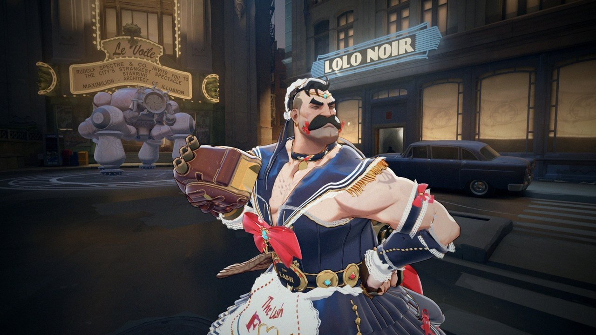
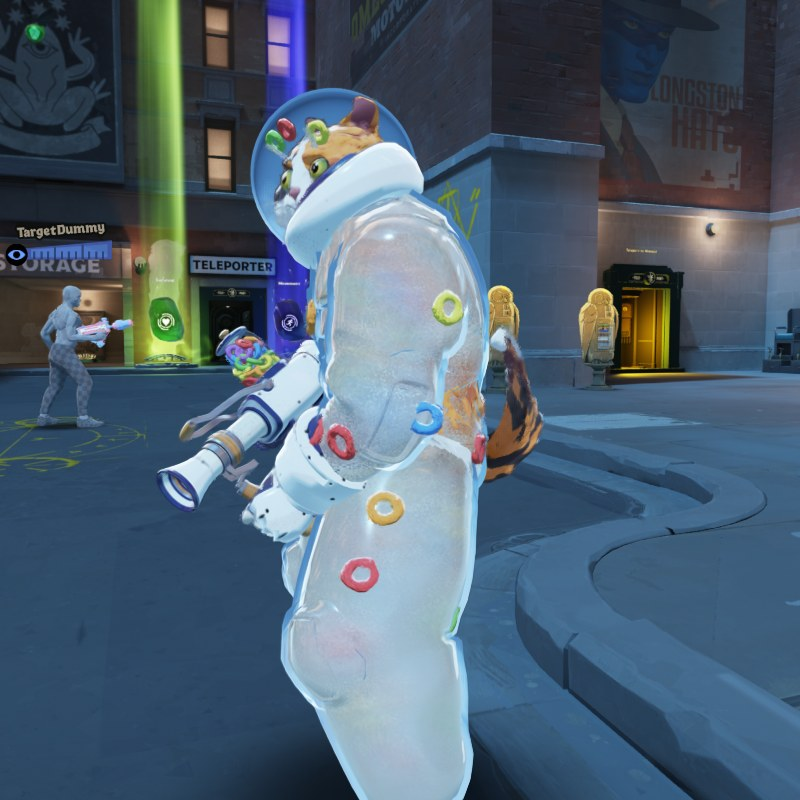

# Made with Magician

Two of the three full hero skins built with this toolchain, and what Magician says about each. Every block below is
what `magician check` or `magician grade` printed on Deadlock build 6868, less the lines that name files on the
author's disk; the proof ledger is the skin's own `proofs.tsv` without its hash and evidence columns. The lint rows
are the same bytes linted again with the rules as measured against Valve's heroes on 6871 (the changelog says what
moved). The third skin
is not public yet and is not shown.

## Maid Lash



A complete Lash skin: outfit, cloth, effects, HUD art, animation and sound. It is public: it installs through
Deadlock Mod Manager from [its page](https://woflo.dev/deadlock-skins/maid-lash/), which `magician source` wrote, and
`magician publish nexus` put it on [Nexus Mods](https://www.nexusmods.com/deadlock/mods/20).

```
maid-lash: ok  Costume (look, effects, sound)  (build 6868)
  lint   warn   0 error(s), 36 warning(s), 4 allowed (deep; fair play pass)
         on the hero    M111 floating-shell x8, M102 open-sheet-void x6, M108 z-fighting x5, M113 uv-degenerate x3, M104 normals-flipped x1, M105 degenerate-triangles x1, M107 backface-shading x1, M109 self-intersection x1, M110 shell-intersection x1, M117 skin-influences x1, M118 skin-distant-bone x1, M125 seam-crack x1, M136 albedo-range x1, M148 default-slot-literal x1
         frame cost     M122 lod-budget x2, M123 mesh-budget x1
         the pak        M100 mesh-unchecked x1
         advisory       M081 particle-energy x3, M130 hitbox-envelope-wide x1 (fair play's advisories: reported, never a violation)
  grade  ok     Costume (look, effects, sound) for Lash; release gate pass
  proof  ok     these bytes proven on 6868; 6864, 6865, 6866 (claimed for other bytes or never recorded)
  drift  ok     proven on 6868, the installed build
  scene  ok     lash: the stock map matches the patch
```

What stands behind each line:

- **The lint.** No errors: nothing the game will not load or play. The warnings are counted by rule and grouped by
  where a player meets them, all of them from the mesh family, which measures the model against Valve's; `magician lint` prints each site and
  `magician rules` says what each rule means in game.

- **The grade.** Lash is 2,201 files in the game's own data. The skin ships 644, and the grade says which parts of
  the hero they make its own:

  ```
  Costume: the same character, a new model (character rubric)
    look     model, materials, UI art 11 of 13, scenes 1 of 3
    effects  ability VFX, animation
    sound    kit sound, voice
  ```

- **Fair play.** The skirt is wider than Lash's hitboxes, which is a fair-play finding. It is accepted at that one
  site with a written reason and a measured size, and the grade record carries the numbers: 11.27 units at the worst
  point against a limit of 18, on 0.39% of the visible surface against a limit of 3.5%. It is the only fair-play
  allowance, and the rules that can never be allowed (a smaller silhouette, a hidden cue) found nothing.

- **The proofs.** A proof is of bytes, on a build, after someone looked at the frames. This is the skin's ledger:

  ```
  build  date        owner          file                             crc32
  6864   2026-11-21  maid_lash      pak10_dir.vpk                    3a6a5aff
  6865   2026-11-24  lash_showcase  maps/ui/hero_prefabs/lash.vpk    d287ca64
  6865   2026-11-24  maid_lash      pak10_dir.vpk                    24994007
  6866   2026-11-24  lash_showcase  maps/ui/hero_prefabs/lash.vpk    d287ca64
  6866   2026-11-24  maid_lash      pak10_dir.vpk                    24994007
  6868   2026-11-25  lash_showcase  maps/ui/hero_prefabs/lash.vpk    d287ca64
  6868   2026-11-25  maid_lash      pak10_dir.vpk                    29aea0c5
  6868   2026-11-25  lash_showcase  maps/ui/hero_prefabs/lash.vpk    d287ca64
  6868   2026-11-25  maid_lash      pak10_dir.vpk                    24994007
  6868   2026-11-25  lash_showcase  maps/ui/hero_prefabs/lash.vpk    d287ca64
  6868   2026-11-25  maid_lash      pak10_dir.vpk                    edfd3beb
  ```

  Every rebuild of the pak is a new crc, and each has only the proofs of its own passes. The pak installed now is
  release 1.0.2 (`edfd3beb`), first seen in game on 6868, so 6868 is the one build `check` gives it. 6864, 6865 and
  6866 were proofs of earlier paks, which is why they read "claimed for other bytes": Magician will not lend them to
  bytes nobody saw on those builds.

- **Two game updates.** Builds 6866 and 6868 arrived within a day of each other. Each time `magician patchday` said
  what Valve had changed under the release then installed, `magician reprove` ran its in-game pass, and the proof was
  recorded after the contact sheets were read. The record of both is in [PATCH-DAY.md](PATCH-DAY.md#drills).

- **The hero page.** Its showcase scene is a map of 25 files, 22 of them Valve's. `magician scene` ships the three
  that are the skin's and builds the rest from the player's own game, so no Valve file is handed out.

## Lööps Viscous



Viscous, except a long-haired calico has got into the diving suit. The goo is milk and the skeleton is cereal. It is a
new character on Viscous's rig, 468 files, and it is not released yet.

```
loops-viscous: ok  Echo (look, effects, sound)  (build 6868)
  lint   warn   0 error(s), 17 warning(s), 14 allowed (deep; fair play pass)
         on the hero    M102 open-sheet-void x6, M107 backface-shading x1, M113 uv-degenerate x1, M125 seam-crack x1, M136 albedo-range x1
         other heroes   M090 shared-file x4
         frame cost     M122 lod-budget x2, M123 mesh-budget x1
  grade  ok     Echo (look, effects, sound) for Viscous; release gate pass
  proof  ok     these bytes proven on 6868
  drift  ok     proven on 6868, the installed build
  scene  ok     viscous: the stock map matches the patch
```

A day earlier the same command said `RE-PROVE` and exited 4: the pak loaded with no lint errors, but nobody had
recorded an in-game pass of those bytes, so the label read `unproven` and the release gate was closed. The skin now
has a standing pass (`[ingame] pass` in its `mod.toml`: the hero from every angle and in motion, each ability, the HUD).
`magician session qa` ran it, the contact sheets were read, and `magician prove` wrote the first row of its ledger:

```
build  date        owner          file            crc32
6868   2026-11-26  loops_viscous  pak20_dir.vpk   c4e6ad87
```

```
Echo: a new character (character rubric)
  look     model, materials, UI art, Valve's scenes
  effects  ability VFX, animation
  sound    kit sound, Valve's voice
```

## Try it on your own mod

`magician check` in a mod's folder prints the same report for it. A mod made without Magician gets there with
`magician init` beside its pak, or on the download it came in; [moving-to-magician](../skills/moving-to-magician/SKILL.md)
is the whole route.
